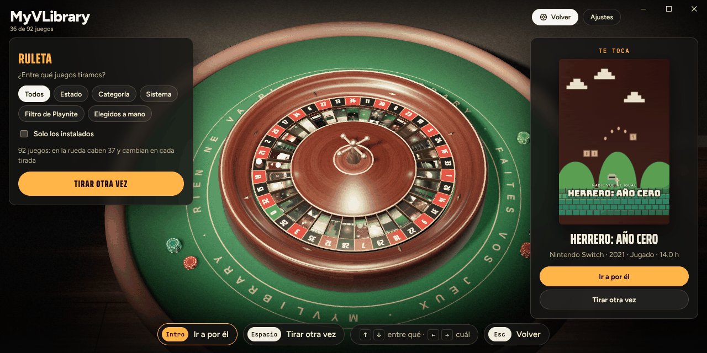
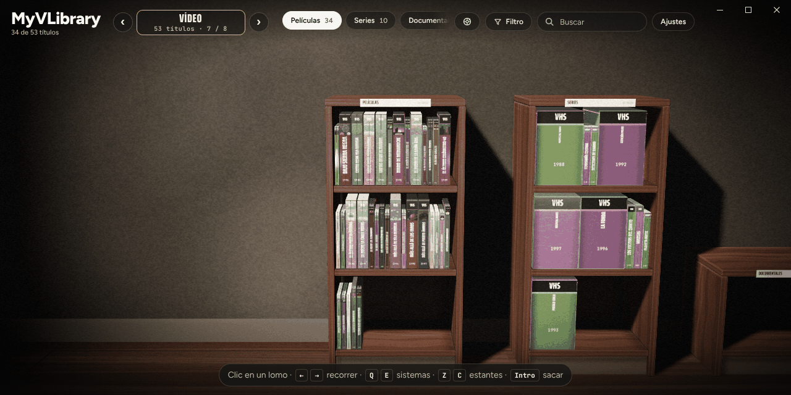

# MyVLibrary

[English](README.md) · **Español**

Tu biblioteca de Playnite convertida en una estantería de juegos físicos.

Cada juego es una caja. La sacas, le quitas el precinto, la abres y metes el disco en el aparato para jugar. La descripción y la ficha del juego están en el manual de dentro, y la contraportada lleva el resumen.

Cada sistema tiene su sitio. Los juegos de PC están en una balda sobre una mesa con un PC beige de los 90 y una pizarra que apunta a rotulador lo que tienes en la mano. Los de cada consola están en un mueble bajo de la tele: te sientas en la alfombra, con la tele a la altura de los ojos y la consola en el suelo, delante. Tus películas pueden tener un videoclub (Jellyfin) y tu música una tienda de discos (Navidrome). Y pasada la última sala hay una mesa de casino con una ruleta para cuando no sabes a qué jugar.

[](https://ko-fi.com/T4Y129OF2M)


## Qué hace

### Tu biblioteca, en estanterías

- **Tu biblioteca real.** Carátulas, fondos, descripciones, tiempo jugado, estados y categorías salen de Playnite. El estado, las categorías, la valoración (estrellas) y las notas que cambies en la estantería se guardan en Playnite. Nada cambia solo.
- **Una sala por sistema.** Con los botones ‹ › junto al nombre del sistema (o Q / E, LB / RB) vas de un sistema a otro. Solo salen los sistemas que tienes en Playnite. El PC va en la mesa; el resto, en la sala de la tele, con tele de tubo hasta la generación de PS2 y tele plana a partir de PS3, Xbox 360 y Wii.
- **Tres diseños.** Salas por sistema (el de las imágenes), una sola balda larga sobre la mesa con la tele y la consola, o una fila de estanterías (una por estado, categoría o plataforma). Se cambia en Ajustes → Diseño.
- **Estantes.** Arriba eliges qué hay en la balda: todos los juegos o un estado (Jugando, Superados…). También puedes agruparlos por categoría, plataforma o formato. Si hay más de los que caben arriba, se recorren con la rueda del ratón o con su barra de desplazamiento; si una balda está llena, tiene páginas («Siguiente»).
- **Filtros.** El botón Filtro de arriba enseña todos los juegos, solo los instalados o solo los que deja pasar uno de los filtros que tengas guardados en Playnite. Con F en el teclado (Y en el mando) pasas al siguiente. Cada opción dice cuántos juegos deja, y la que no deja ninguno no se puede elegir. Las salas que se quedan vacías no aparecen.
- **La ruleta.** El botón Ruleta de arriba (R en el teclado, Back / View en el mando) te lleva a una mesa de casino pasada la última sala. Eliges qué juegos van en la rueda: todos, un estado, una categoría o un sistema, uno de tus filtros guardados de Playnite o los que marques a mano, y si quieres solo los instalados. Cada casilla lleva la carátula de un juego. Tiras, y cuando la bola se para, «Ir a por él» te lleva a la sala de ese juego y te lo pone en las manos.

### Las cajas

- **El formato que quieras.** Cada juego de PC puede ir en una caja DVD, una caja de CD, una caja de CD grande (como las de PlayStation o Dreamcast PAL), una caja grande de cartón, una caja de disquetes de 3½" de finales de los 90 o una caja de cartucho de 16 bits. Lo eliges en la ficha del juego (Formato) y puedes mezclarlos en la misma balda. Si no eliges nada, va según el año: disquetes antes de 1994, caja de CD de 1994 a 2003 y DVD después.
- **Cada consola, con su formato.** Los juegos de consola van en la caja y el medio de su sistema: PlayStation en caja de CD grande, PS2 y posteriores en caja DVD, Super Nintendo, Nintendo 64 o Switch en cartucho… Así la consola siempre recibe lo que espera. Si quieres cambiarlos, en Ajustes → Formato en consolas elige «Libre».
- **Escaneos reales: portada, contraportada, lomo, disco, manual.** Cada caja puede llevar la contraportada, el lomo y el disco (o la etiqueta del cartucho) reales de tu copia y la portada de su manual, y una portada escaneada sale tal cual está impresa. Se añaden desde la ficha de la caja (Imágenes de la caja): un escaneo completo (contraportada, lomo y portada en una sola imagen, que se corta según las proporciones de la caja) o cada parte por separado, portada incluida. Se guardan en la carpeta ExtraMetadata del juego (`ExtraMetadata\games\<id del juego>\`), y también se usan las que otras herramientas dejen ahí con los nombres habituales: `Front`, `Box - Front`, `Back`, `Box - Back`, `Spine`, `Box - Spine`, `Disc`, `Cart - Front`, `Manual`, `Full`, `Box - Full`… en PNG, JPG o WebP.
- **Encuadre.** Si una imagen se corta o se pasa (el borde blanco del escáner, un lomo más ancho de lo que espera la caja, una foto del disco), **Ajustar encuadre** en la ficha la abre entera con un recuadro encima. Lo que queda dentro del recuadro va a esa cara de la caja: arrastra el recuadro o sus bordes, acerca y aleja con la rueda y, en un escaneo completo, lleva las dos líneas a los cantos del lomo. **Detectar bordes** quita el borde del escáner solo (y en un escaneo completo busca también el lomo), **Rellenar** y **Entera** lo encuadran sin estirarlo, **Toda la imagen** la estira entera a la cara y **Girar 90°** pone de pie una imagen que venía tumbada. Cada cara tiene su pestaña: el escaneo completo entero y luego la portada, la contraportada y el lomo (si salen del escaneo completo, cada una se encuadra dentro de su parte), el manual y el disco. Sin un escaneo del manual, su portada se hace con la imagen de la portada: encuádrala ahí y, si quieres, quítale la franja «Manual de instrucciones». Una vista previa enseña cada cara tal como va a quedar, y la caja que tienes en las manos cambia mientras ajustas. También sirve para la portada normal de Playnite. El encuadre se guarda junto a las imágenes (`MyVLibrary.json` en la misma carpeta); si cambias una imagen, su encuadre se olvida.
- **Esquinas como las reales.** Una caja de DVD apenas está redondeada y una de cartón es cuadrada. Si prefieres el aspecto más suave: Ajustes → Esquinas de las cajas → Redondeadas.
- **Precinto y polvo.** Un juego que nunca has abierto llega precintado: tira de la lengüeta roja para quitar el precinto. Lo que llevas tiempo sin tocar coge polvo, y se quita frotando la caja.

### Jugar

- **Aparatos para cada medio.** El PC tiene bandeja de CD que sale y entra, disquetera con su luz y una ranura de cartuchos arriba. La consola genérica ID-2 tiene ranura de discos, disquetera y ranura de cartuchos. El disco, el disquete o el cartucho entran por donde les toca.
- **Jugar de verdad.** Al meter el disco, Playnite arranca el juego. Mientras juegas, la tele lo enseña y la caja espera cerrada junto al aparato. Al cerrar el juego, la caja se abre, el disco vuelve solo a ella y la caja vuelve a su sitio en la estantería. Si Playnite da el juego por cerrado pero sigue abierto algún programa de su carpeta, el disco se queda dentro hasta que lo cierres y ese tiempo se suma a tus horas.
- **Instalar desde la ficha.** Dentro de Playnite, la ficha del juego tiene una fila Instalación: instalarlo o desinstalarlo (se encargan Playnite y la tienda del juego), abrir su carpeta, verlo en Playnite o marcarlo como instalado o no instalado cuando Playnite lo tiene mal. Marcarlo solo cambia lo que Playnite tiene apuntado: no instala ni borra nada.
- **Tráiler.** La tele y la contraportada ponen el tráiler del juego: el de Extra Metadata Loader si lo tienes, o el vídeo que venga en la descripción.

### Aspecto

- **Luz de cine y estudio.** La habitación está a oscuras, con un foco cálido desde arriba a la izquierda y un poco de grano de película. Al sacar algo de la estantería, la habitación se funde tras un fondo gris de estudio y unas ventanas de luz iluminan la caja: se gira hacia ti al abrirse y se asienta con un pequeño rebote al cerrarse, puedes arrastrarla para girarla en la mano y sus esquinas sueltan pequeños destellos. Para seguir viendo la habitación detrás: Ajustes → Al sacar algo de la estantería → En la habitación.
- **Mirar de cerca.** Pasa el ratón por encima de un juego, o llega a él con el mando, y la vista se acerca para que leas bien los lomos. Elige cuánto en Ajustes → Zoom al pasar por encima (Suave, Normal, Mucho o No). Para más: Vista de la estantería → Más cerca deja la vista acercada siempre, y Rueda del ratón → Acerca y aleja hace que la rueda acerque hacia donde apuntas (entonces las páginas se pasan con los botones y las flechas). En el teclado, + y − acercan y alejan, y 0 vuelve.
- **La tele y la pizarra.** Al cambiar lo que sale en la tele hay un golpe de nieve y el número de canal en pantalla, y la pizarra escribe lo que tienes en la mano trazo a trazo.
- **Ambientes y luces.** Salón, Nórdico, Acogedor, Cabaña, Japonés, Biblioteca, Loft, Videoclub, Gamer y Nave, con cuatro luces: cine, noche, tarde y día.
- **Tu idioma.** La estantería sigue el idioma de Playnite (por ahora español e inglés).




### Películas, música y EmuVR

- **Videoclub (Jellyfin).** Vincula tu servidor de Jellyfin en los ajustes de la extensión (Complementos → MyVLibrary) y tus películas y series aparecen en una sala nueva, como un videoclub: una estantería por biblioteca. Lo anterior a 1997 sale en VHS, hasta 2014 en DVD y después en Blu-ray, y cada película o temporada se puede cambiar. Una serie ocupa un solo lomo; al sacarla eliges la temporada y llega en una caja de cartón con seis cintas o en una caja de DVD/Blu-ray con bandeja abatible y cuatro discos a la vista. Con las flechas pasas a los capítulos siguientes y con el buscador vas directo a uno. Si lo dejaste a medias, eliges retomarlo o empezar de nuevo. La cinta va a un vídeo junto a la tele de tubo y el disco a un reproductor junto a la tele plana (genéricos, los del EmuVR estándar o cualquier `.ugc`), y se ve en el reproductor de Windows o en VLC. Al cerrar el reproductor vuelve sola a su caja. Si Jellyfin no está vinculado, la sala no aparece.
- **Tienda de discos (Navidrome).** Vincula tu servidor de Navidrome en los ajustes de la extensión (pestaña Música) y aparece una tienda de discos con estanterías de álbumes, artistas, canciones y listas. Hasta 1972 sale en vinilo, hasta 1999 en casete y después en CD; las listas, en CD. Se cambia en cada disco o, para todos los álbumes, listas o canciones (o todo a la vez), en Ajustes → Música. Un álbum o una lista se pone entero en una cadena de los 90 con altavoces: tocadiscos arriba, CD con bandeja en medio y pletina abajo, con botones de reproducir y pausa, canción anterior y siguiente, volumen y parar y expulsar. Las canciones sueltas y las de cada artista van a una bolsa: una sola suena tal cual; varias se graban antes en el ordenador en un CD o un casete (a tu elección) que solo dura mientras suena. La música sigue sonando mientras recorres la biblioteca, con un pequeño reproductor en pantalla. Opcionalmente, los vinilos y casetes se dan la vuelta a mitad. Si Navidrome no está vinculado, la tienda no aparece.
- **Tus consolas de EmuVR.** En Ajustes → EmuVR puedes elegir un archivo `.ugc` de EmuVR para cada sistema, y otro para la tele de tubo, la tele plana o el monitor. Al entrar en la sala de ese sistema, el modelo sustituye a la consola genérica y se mueve como lo animó su autor en EmuVR: la tapa o la bandeja se abre, la ranura se traga el disco, el cartucho se hunde en su ranura y el botón de encendido se hunde. El juego va donde está el socket del medio del modelo, en la dirección en que lo mueven sus animaciones; sin animaciones, por la salida del socket que esté libre (desde arriba, una ranura de lado…), y si la abertura es estrecha (una portátil, un UMD) el medio se hace más pequeño. Las consolas que trae el propio EmuVR (Nintendo 64, PlayStation, PlayStation 2, GameCube, NES, las tres Super Nintendo, el vídeo…) no son `.ugc`: **Leer carpeta de EmuVR** las lee de tu instalación de EmuVR y las ofrece en cada sistema. Si queda al revés, el botón ↻ lo gira. Los modelos se leen en tu equipo y se guardan en los datos de la extensión: la extensión no incluye ninguno y no se suben a ningún sitio. Los `.ugc` comprimidos con LZMA todavía no se pueden leer.
- **Decora las salas.** Cada sala de sistema puede tener sus cosas: figuras, la caja de la consola, otra consola de exposición, cualquier cosa que haya como `.ugc` de EmuVR. En Ajustes → EmuVR → Decoración de la sala, añade un `.ugc` (o una de las consolas que trae EmuVR, cuando ya hayas leído su carpeta) y aparece en la sala en la que estás. **Colocar** te deja arrastrar cada cosa a cualquier superficie plana (la alfombra, el mueble, encima de la tele, la mesa, otra cosa); la rueda la gira y Mayús + rueda cambia su tamaño. Con el teclado o el mando: flechas para moverla, Q / E (LB / RB) para girarla, Z / C (LT / RT) para el tamaño, M (X) pasa a la siguiente, Supr la quita e Intro o Esc (A / B) terminan. Va en el diseño Por sistema; los archivos se guardan en este equipo, como los demás `.ugc`.




## Instalar

Necesitas:

- Playnite 10.36 o posterior.
- Microsoft WebView2. Viene con Windows 10 y 11; si falta, la extensión te avisa.

Pasos:

1. Descarga el último `MyVLibrary_x_y_z.pext` de [Releases](../../releases). Para la última versión en desarrollo, abre la ejecución más reciente en la pestaña **Actions** y descarga el artefacto `MyVLibrary-pext`, que viene dentro de un .zip.
2. Haz doble clic en el `.pext` o arrástralo a la ventana de Playnite.
3. Reinicia Playnite cuando te lo pida.

**Actualizaciones.** Al arrancar Playnite, la extensión mira en GitHub si hay una versión más nueva y, si la hay, te la ofrece en una notificación de Playnite: haz clic en ella, se descarga el `.pext` y Playnite te pregunta si quieres instalarlo. También puedes mirarlo a mano en **Extensiones → MyVLibrary → Buscar actualizaciones**, y quitar el aviso en los ajustes de la extensión.

## Usar

**Modo escritorio**

Tienes tres formas de abrir la estantería:

- En la barra lateral, con el icono del disco.
- Desde el menú principal: **Extensiones → MyVLibrary → Abrir la estantería en una ventana**.
- Con clic derecho sobre un juego: **MyVLibrary → Ver en la estantería**. Abre la estantería justo en ese juego.

En la barra lateral, la estantería tapa los botones de ventana de Playnite, así que pone los suyos arriba a la derecha (minimizar, maximizar y cerrar). Arrastra la barra de arriba para mover la ventana y haz doble clic en ella para maximizarla.

**Modo pantalla completa**

- Se abre sola al arrancar Playnite. Se puede desactivar en los ajustes de la extensión.
- **LB + RB** a la vez la abren y la cierran.
- **B** en la estantería vuelve a Playnite.

**Controles**

| | Ratón | Teclado | Mando |
|---|---|---|---|
| Recorrer la balda | pasar por encima | ← → (↑ ↓ saltan de 8 en 8) | cruceta / stick |
| Sacar un juego | clic en el lomo | Intro | A |
| Girar la caja | clic en la caja, o arrastrarla | F | Y |
| Quitar el precinto | arrastrar la lengüeta | Intro | A |
| Abrir la caja / meter el disco | botones de abajo | Intro | A |
| Leer el manual | clic en el manual | M | X |
| Enseñar u ocultar la ficha | Ficha, arriba a la izquierda | I | Back / View |
| Acercar la estantería | rueda (si está para acercar) | + / − / 0 | |
| Filtrar (todos, instalados, tus filtros de Playnite) | botón Filtro de arriba | F | Y |
| Ruleta: entrar | botón Ruleta | R | Back / View |
| Ruleta: tirar / ir a por él | Tirar, clic en la rueda / Ir a por él | Intro o Espacio / Intro | A o Y / X |
| Ruleta: entre qué juegos | botones de la izquierda | ↑ ↓ (entre qué) · ← → (cuál) | cruceta |
| Cambiar de sistema (salas por sistema) | ‹ › junto al sistema | Q / E | LB / RB |
| Cambiar de estante | los botones de arriba | Q / E (Z / C en salas por sistema) | LB / RB (LT / RT en salas por sistema) |
| Cambiar de página | «Siguiente» | Re Pág / Av Pág | LT / RT |
| Encuadrar una imagen (Ajustar encuadre en la ficha) | arrastrar el recuadro, sus bordes o las líneas del lomo; la rueda acerca y aleja | flechas mover · Q / E otro borde · Z / C zoom · F girar · M otra cara · Intro guardar · Esc cancelar | cruceta · LB / RB · LT / RT · Y · X · A / B |
| Decorar una sala (Colocar) | arrastrar una cosa; la rueda la gira, Mayús + rueda cambia su tamaño | flechas mover · Q / E girar · Z / C tamaño · M siguiente · Supr quitar · Intro / Esc terminar | cruceta · LB / RB · LT / RT · X · A / B |
| Volver | | Esc | B |
| Cambiar de ambiente | Ajustes | H | |

**Ajustes de la estantería** (el botón Ajustes de arriba a la derecha):

- **General:** diseño, cómo se agrupan los estantes, orden, formato en consolas, precinto (preguntar, a mano o quitar solo) y si la ficha sale plegada o abierta.
- **Ambiente:** ambiente y luz, sonido y volumen de los efectos, tráiler, zoom al pasar por encima, vista de la estantería, rueda del ratón, esquinas de las cajas y qué pasa al sacar algo de la estantería.
- **Música:** el formato de álbumes, listas y canciones, en qué se graban tus mezclas, dar la vuelta a vinilos y casetes, volumen de la música.
- **EmuVR:** la decoración de la sala en la que estás, los modelos `.ugc` de cada sistema y pantalla, y Leer carpeta de EmuVR.

**Ajustes de la extensión** (Playnite → Complementos → MyVLibrary):

- **Estantería:** abrir la estantería al iniciar Playnite en pantalla completa, LB + RB para abrirla y cerrarla, poner también los juegos ocultos, mantener el disco dentro mientras el juego siga abierto, avisar cuando haya una versión nueva, herramientas de desarrollo (F12).
- **Vídeo (Jellyfin):** servidor, usuario, bibliotecas y reproductor (el de Windows o VLC).
- **Música (Navidrome):** servidor y usuario.

## Qué se guarda y dónde

- **En Playnite:** estado de juego, categorías, puntuación de usuario (cada estrella son 20 puntos) y notas. Las imágenes de la caja que añadas desde la ficha, y cómo las encuadres, van a la carpeta ExtraMetadata del juego.
- **En los datos de la extensión:** el precinto, el polvo y el formato que hayas elegido para cada caja, las preferencias de la estantería (ambiente, luz, orden, sistema, filtro, zoom, qué va en la ruleta), los `.ugc` que hayas elegido, la decoración de cada sala, las consolas leídas de la carpeta de EmuVR, la lista de películas y series de Jellyfin con su token de acceso (nunca la contraseña), la lista de música de Navidrome con su contraseña cifrada para tu usuario de Windows (su API la pide en cada petición), una caché de carátulas reducidas y otra de las últimas canciones escuchadas (hasta 1 GB). Si nunca cambias el formato de un juego, usa el que le toca por su plataforma.

## Desarrollo

```
MyVLibrary/
├─ web/          la estantería (three.js), por piezas en web/src
│  └─ build.mjs  las junta en web/dist (para la extensión) o web/dist-demo (demo para el navegador)
├─ extension/    la extensión de Playnite (C#, .NET Framework 4.6.2, WebView2)
└─ .github/workflows/build.yml   compila todo y empaqueta el .pext
```

**La estantería en el navegador**

```
cd web
npm install
node build.mjs --target=demo   # web/dist-demo/index.html, con juegos de muestra
node build.mjs                 # web/dist/, lo que lleva la extensión
```

- Abre `web/dist/index.html` desde un servidor estático (por ejemplo `npx serve web`) para ver la biblioteca de muestra.
- Añade `?mock` al final de la dirección y la página hace como si estuviera dentro de Playnite. Así se prueba el camino real: carátulas, colores sacados de la carátula, arrancar y cerrar un juego, filtros guardados, los botones de la ficha y los cambios que se devuelven. Con `?mock&running=<id>` la estantería se abre con ese juego ya en marcha, y con `?mock&real` los juegos de mentira cuentan como reales, para probar las imágenes de la caja y su encuadre.

**La extensión**

- Se compila con `dotnet build extension/MyVLibrary.csproj -c Release`, en Windows, después de construir la parte web.
- GitHub Actions lo hace en cada cambio y guarda el `.pext` como artefacto.
- Si subes una etiqueta `v*` (por ejemplo `v0.9.0`), además publica una versión, que es lo que ofrece el aviso de actualización.
- **Versión.** Está en `extension/extension.yaml` (y repetida en `web/package.json`). La DLL y la estantería la toman de ahí; se ve al final de Ajustes. Cada PR que toque `extension/` o `web/` tiene que subirla: si no, la comprobación de GitHub Actions falla. Solo números y puntos (como `0.9.0`): Playnite rechaza cualquier otra cosa, como `0.7.1-hotfix`, con «The extension is not packaged properly». La etiqueta de una versión tiene que ser exactamente `v` más la versión (`v0.9.0`).

**Cómo se hablan las dos partes**

- La extensión sirve la carpeta `web` en `https://app.myvlibrary/`, las carátulas en `https://media.myvlibrary/cover/{id}?w=…` (reducidas y en caché) y la carpeta ExtraMetadata (logos, tráileres, imágenes de las cajas) en `https://extra.myvlibrary/`.
- La página y la extensión se mandan mensajes JSON con `chrome.webview.postMessage`.
- La página pide: `ready`, `detail`, `start`, `update`, `openUrl`, `close`, `fetch`, `createStatus`, `createCategory`, `release`, `game`, `setArt`, `setFit` y `window`, además de los `jf…` y `nd…` de Jellyfin y Navidrome.
- La extensión responde con `library`, `games`, `removed`, `lists`, `detail`, `started`, `tracking`, `stopped`, `cancelled`, `notInstalled`, `failed`, `activated`, `fetched`, `pad`, `focus`, `notice` y `winState`, además de los de vídeo y música.

## Agradecimientos

La luz de cine, el fondo de estudio y la forma en que la caja se abre y se cierra están inspirados en el vídeo «CD Shelf» que se compartió en r/spicetify y en el [cd-case](https://github.com/annnguyentt/vibe-coding/tree/main/cd-case) de Ann Nguyen.

## Licencia

GPL-3.0. Los juegos de la demo son inventados, y la consola, el PC, las teles, el monitor y la ruleta son diseños originales. Los modelos de EmuVR, incluidos los que trae EmuVR, son de sus autores: la extensión no incluye ni distribuye ninguno.
