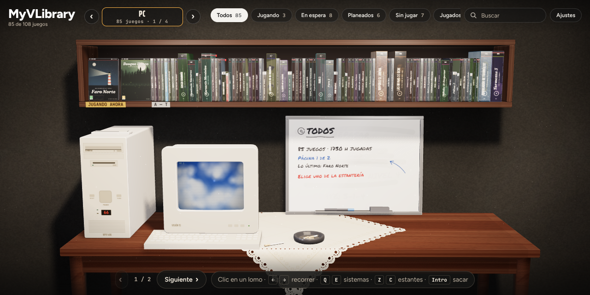
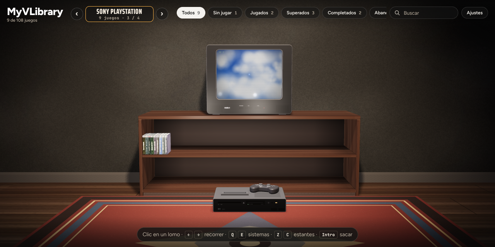
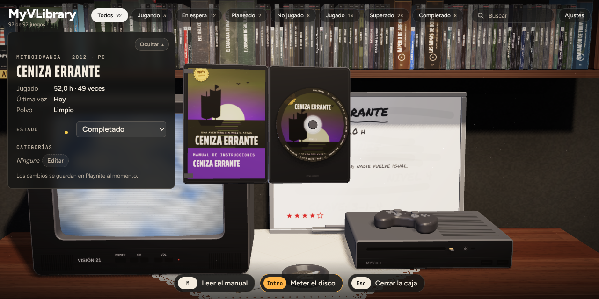
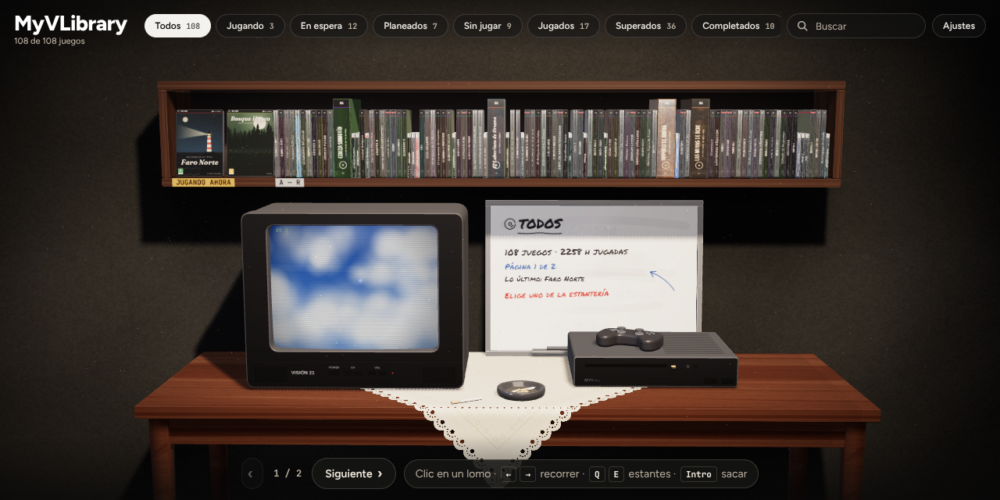

# MyVLibrary

**English** · [Español](README.es.md)

Your Playnite library turned into a shelf of physical games.

Every game is a case. You take it down, peel off the shrink wrap, open it and put the disc in the console to play. The description and the game's details are in the manual inside, and the back cover has the summary.

Each system has its own place. PC games sit on a shelf above a desk with a beige 90s PC (CD-ROM drive, floppy drive and a CRT monitor) and a whiteboard that writes down in marker whatever you are holding. Each console's games are kept in the low TV cabinet: you sit on the rug, with the TV at eye height and the console on the floor in front of it.





## What it does

- **Your real library.** Covers, backgrounds, descriptions, playtime, completion statuses and categories come from Playnite.
- **Shelves.** At the top right you choose what is on the shelf: all your games or one status (Playing, Beaten…). You can also group them by category, platform or format. If they don't fit, the shelf has pages ("Next").
- **Any format you like.** Each PC game can come in a DVD case, a CD jewel case, a big CD case (like the PAL PlayStation or Dreamcast ones), a cardboard big box, a late-90s box of 3½" floppies or a 16-bit cartridge box. Pick it in the game's card (Format) and mix them on the same shelf. The case in your hands changes on the spot, and the shelf makes room when you put it back. If you don't pick one, it goes by year: floppies before 1994, a CD case from 1994 to 2003 and a DVD case after that.
- **Each console with its own format.** Console games come in their system's case and medium: PlayStation in a big CD case, PS2 and later in a DVD case, Super Nintendo, Nintendo 64 or Switch on a cartridge… so the console always gets what it expects. To change them, set Settings → Console formats to "Free".
- **A place per system.** The ‹ › buttons next to the system name (or Q / E, LB / RB) walk you from one system to the next. Only the systems you have in Playnite show up. PC games are on the desk; the rest are in the TV room: a CRT up to the PS2 generation and a flat TV from the PS3, Xbox 360 and Wii on.
- **Machines for every medium.** The PC has a CD tray that slides out and back, a floppy drive with its light and a cartridge slot on top. The generic ID-2 console has a disc slot, a floppy drive and a cartridge slot. Discs, floppies and cartridges each go in where they belong.
- **Video room (Jellyfin).** Link your Jellyfin server in the extension's settings (Add-ons → MyVLibrary) and your films and series appear in a new room, like a video shop: one bookcase per library. Anything before 1997 comes on VHS, up to 2014 on DVD and after that on Blu-ray, and each film or season can be changed. A series takes a single spine; take it out, pick the season and it comes in a cardboard box of six tapes or in a DVD/Blu-ray case with a flip tray and four discs in view. The arrows bring the next episodes and the search goes straight to one. If you stopped halfway, you choose to resume or start over. The tape goes into a VCR next to the CRT and the disc into a player next to the flat TV (generic ones, EmuVR's own or any `.ugc`), and it plays in Windows' own player or VLC. When you close the player it goes back to its case by itself. Without Jellyfin linked, the room does not appear.
- **Record shop (Navidrome).** Link your Navidrome server in the extension's settings (Music tab) and a record shop appears, with racks of albums, artists, songs and playlists. Up to 1972 it comes on vinyl, up to 1999 on cassette and after that on CD; playlists on CD. Change it on each record or, for all albums, playlists or songs (or everything at once), in Settings → Music. An album or a playlist plays whole on a 90s hi-fi with speakers: turntable on top, CD tray in the middle and cassette deck below, with play and pause, previous and next song, volume, and stop and eject buttons. Single songs and an artist's songs go into a bag: one plays as it is; several are first recorded at the computer onto a CD or a cassette (your choice) that only lasts while it plays. The music keeps playing while you walk around the library, with a small player on screen. Optionally, records and tapes are turned over halfway. Without Navidrome linked, the shop does not appear.
- **Your EmuVR consoles.** In Settings → EmuVR consoles and screens you can pick an EmuVR `.ugc` file for each system, and another one for the CRT TV, the flat TV or the monitor. When you walk into that system's room, the model replaces the generic console and moves the way its author animated it for EmuVR: the lid or the tray opens, the slot-loader pulls the disc in, the cartridge sinks into its slot and the power button goes down. The game goes where the model's media socket is, in the direction its animations move it; without animations, through whichever way out of the socket is open (from above, a slot on the side...), and a tight opening (a handheld, a UMD) gets a smaller medium. The consoles that come with EmuVR itself (Nintendo 64, PlayStation, PlayStation 2, GameCube, NES, the three Super Nintendos, the VCR...) aren't `.ugc` files: **Read EmuVR folder** reads them from your EmuVR installation and offers them on every system. If it faces the wall, the ↻ button turns it around. Models are read on your computer and kept in the extension's data: the extension ships none of them and nothing is uploaded. `.ugc` files compressed with LZMA can't be read yet.
- **Three designs.** By system (the one in the pictures), one long wall shelf above the table with the TV and the console, or a row of bookcases (one per status, category or platform). Change it in Settings → Design.
- **Actually playing.** When you put the disc in, Playnite starts the game. While you play, the TV shows it and the case waits, closed, beside the machine: on the desk right of the monitor, or on the rug next to the console. When you close the game, the case opens, the disc goes back into it on its own and the case returns to its place on the shelf. If Playnite thinks the game has closed but a program from its folder is still open, the disc stays in until you close it, and that time is added to your playtime.
- **Trailer.** The TV and the back cover play the game's trailer: the one from Extra Metadata Loader if you have it, or a video found in the description.
- **Your language.** The shelf follows Playnite's language (Spanish and English for now).
- **Unplayed games.** If you have never opened a game, it arrives shrink-wrapped. Pull the red tab to peel the wrap off.
- **Dust.** Games you haven't touched in a while gather dust, and you wipe it off by rubbing the case.
- **Changes saved to Playnite.** Status, categories, rating (stars) and notes. Nothing changes by itself, only when you change it.
- **Rooms.** Living room (the one in the picture), Nordic, Cosy, Cabin, Japanese, Library, Industrial loft, Video store, Gamer and Spaceship. There are also three lights: night, evening and day.





## Install

You need:

- Playnite 10.36 or later.
- Microsoft WebView2. It comes with Windows 10 and 11; if it's missing, the extension tells you.

Steps:

1. Download the latest `MyVLibrary_x_y_z.pext`. It's in [Releases](../../releases) or, for the latest development build, in the **Actions** tab: open the latest run and download the `MyVLibrary-pext` artifact, which comes inside a .zip.
2. Double-click the `.pext`, or drag it onto the Playnite window.
3. Restart Playnite when it asks you to.

## Use

**Desktop mode**

There are three ways to open the shelf:

- From the sidebar, with the disc icon.
- From the main menu: **Extensions → MyVLibrary → Open the shelf in a window**.
- Right-click a game: **MyVLibrary → Show on the shelf**. The shelf opens right on that game.

**Fullscreen mode**

- It opens on its own when Playnite starts. You can turn this off in the extension's settings.
- **LB + RB** together open and close it.
- **B** on the shelf goes back to Playnite.

**Controls**

| | Mouse | Keyboard | Controller |
|---|---|---|---|
| Move along the shelf | hover | ← → (↑ ↓ jump 8 at a time) | d-pad / stick |
| Take a game out | click the spine | Enter | A |
| Turn the case | click the case | F | Y |
| Peel off the shrink wrap | drag the tab | Enter | A |
| Open the case / insert the disc | buttons at the bottom | Enter | A |
| Read the manual | click the manual | M | X |
| Change system (By system design) | ‹ › next to the system | Q / E | LB / RB |
| Change shelf | pills at the top | Q / E (Z / C in the By system design) | LB / RB (LT / RT in the By system design) |
| Change page | "Next" | Page Up / Page Down | LT / RT |
| Go back | | Esc | B |
| Change room | Settings | H | |

**Extension settings** (Playnite → Add-ons → MyVLibrary):

- Open the shelf when Playnite starts in fullscreen.
- LB + RB to open and close it.
- Include hidden games.
- Keep the disc in while the game is still open.
- Developer tools (F12).

## What is saved, and where

- **In Playnite:** completion status, categories, user score (each star is 20 points) and notes.
- **In the extension's data:** the shrink wrap, dust and chosen format of each case, the shelf preferences (room, light, sort order, system), the `.ugc` files you picked, the EmuVR consoles read from its folder, the list of Jellyfin films and series with its access token (never the password), the Navidrome music list with its password encrypted for your Windows user (its API needs it for every request), a cache of downsized covers and another of the songs played most recently (up to 1 GB). If you never change a game's format, it uses the one its platform suggests.

## Development

```
MyVLibrary/
├─ web/          the shelf (three.js), split into pieces in web/src
│  └─ build.mjs  joins them into web/dist (for the extension) or web/dist-demo (browser demo)
├─ extension/    the Playnite extension (C#, .NET Framework 4.6.2, WebView2)
└─ .github/workflows/build.yml   builds everything and packs the .pext
```

**The shelf in the browser**

```
cd web
npm install
node build.mjs --target=demo   # web/dist-demo/index.html, with sample games
node build.mjs                 # web/dist/, what the extension ships
```

- Open `web/dist/index.html` from a static server (for example `npx serve web`) to see the sample library.
- Add `?mock` to the end of the address and the page pretends to be inside Playnite. This tests the real path: covers, colours taken from the cover, starting and closing a game, and changes sent back. With `?mock&running=<id>` the shelf opens with that game already running.

**The extension**

- Build it with `dotnet build extension/MyVLibrary.csproj -c Release`, on Windows, after building the web part.
- GitHub Actions does this on every change and keeps the `.pext` as an artifact.
- If you push a `v*` tag (for example `v0.2.0`), it also publishes a release.
- **Version.** It lives in `extension/extension.yaml` (and is repeated in `web/package.json`). The DLL and the shelf read it from there; you can see it at the bottom of Settings. Every PR that touches `extension/` or `web/` must raise it, or the GitHub Actions check fails. A release tag must match it.

**How the two parts talk**

- The extension serves the `web` folder at `https://app.myvlibrary/` and covers at `https://media.myvlibrary/cover/{id}?w=…`, downsized and cached.
- The page and the extension exchange JSON messages with `chrome.webview.postMessage`.
- The page sends: `ready`, `detail`, `start`, `update`, `openUrl`, `close`, `fetch`, `createStatus`, `createCategory` and `release`.
- The extension answers with `library`, `games`, `removed`, `lists`, `detail`, `started`, `tracking`, `stopped`, `cancelled`, `notInstalled`, `failed`, `activated`, `fetched`, `pad` and `focus`.

## License

GPL-3.0. The demo games are made up, and the console, the PC, the TVs and the monitor are original designs. EmuVR models, including the ones that come with EmuVR, belong to their authors: none are included in or distributed with the extension.
