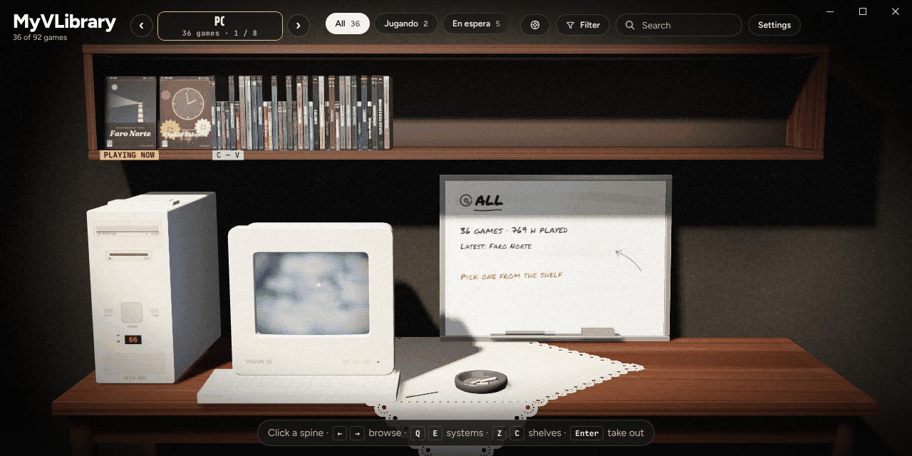
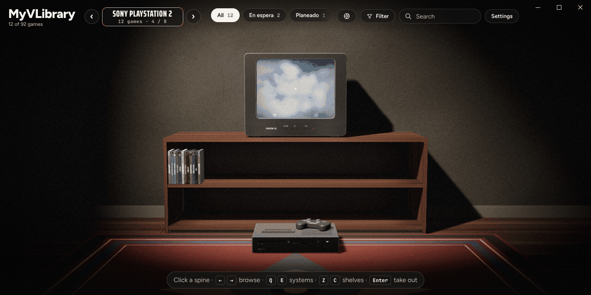
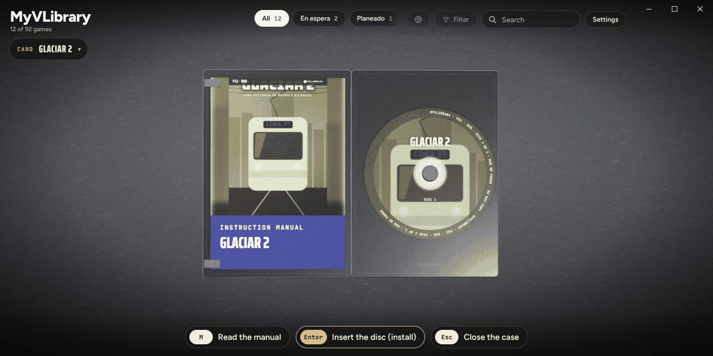
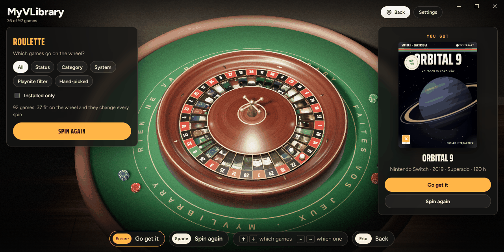
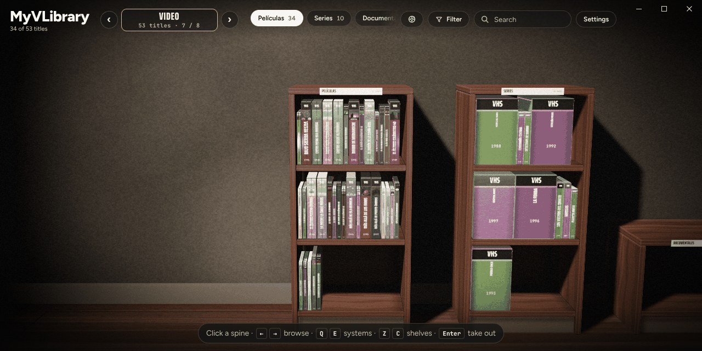
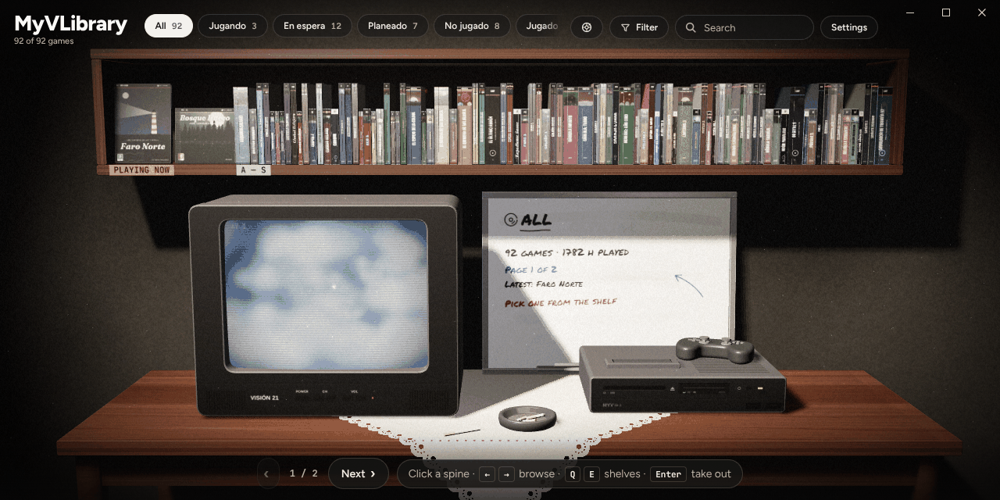

# MyVLibrary

**English** · [Español](README.es.md)

Your Playnite library turned into a shelf of physical games.

Every game is a case. You take it down, peel off the shrink wrap, open it and put the disc in the machine to play. The description and the game's details are in the manual inside, and the back cover has the summary.

Each system has its own place. PC games sit on a shelf above a desk with a beige 90s PC and a whiteboard that writes down, in marker, whatever you are holding. Each console's games are kept in a low TV cabinet: you sit on the rug, with the TV at eye height and the console on the floor in front of it. Your films can have a video shop (Jellyfin) and your music a record shop (Navidrome). Past the last room there is a casino table with a roulette for when you can't decide what to play.

[](https://ko-fi.com/T4Y129OF2M)





## What it does

### Your library, on shelves

- **Your real library.** Covers, backgrounds, descriptions, playtime, completion statuses and categories come from Playnite. Status, categories, rating (stars) and notes you change on the shelf are saved back to Playnite. Nothing changes by itself.
- **A room per system.** The ‹ › buttons next to the system name (or Q / E, LB / RB) walk you from one system to the next. Only the systems you have in Playnite show up. PC games are on the desk; the rest are in the TV room, with a CRT up to the PS2 generation and a flat TV from the PS3, Xbox 360 and Wii on.
- **Three designs.** By system (the one in the pictures), one long wall shelf above the table with the TV and the console, or a row of bookcases (one per status, category or platform). Change it in Settings → Design.
- **Shelves.** At the top you choose what is on the shelf: all your games or one status (Playing, Beaten…). You can also group them by category, platform or format. If there are more than fit in the top bar, scroll it with the mouse wheel or its scroll bar; if a shelf is full, it has pages ("Next").
- **Filters.** The Filter button at the top shows every game, only the installed ones, or only the games one of your saved Playnite filters (filter presets) lets through. F on the keyboard (Y on the controller) moves to the next one. Each choice says how many games it leaves, and one that leaves none can't be picked. Rooms left empty are skipped.
- **The roulette.** The Roulette button at the top (R on the keyboard, Back / View on the controller) takes you to a casino table past the last room. Choose which games go on the wheel: all of them, one status, category or system, one of your saved Playnite filters or the ones you tick by hand, and if you like only the installed ones. Each pocket holds a game's cover. Spin, and when the ball settles, *Go get it* takes you to that game's room and puts it in your hands.

### The cases

- **Any format you like.** Each PC game can come in a DVD case, a CD jewel case, a big CD case (like the PAL PlayStation or Dreamcast ones), a cardboard big box, a late-90s box of 3½" floppies or a 16-bit cartridge box. Pick it in the game's card (Format) and mix them on the same shelf. If you don't pick one, it goes by year: floppies before 1994, a CD case from 1994 to 2003 and a DVD case after that.
- **Each console with its own format.** Console games come in their system's case and medium: PlayStation in a big CD case, PS2 and later in a DVD case, Super Nintendo, Nintendo 64 or Switch on a cartridge… so the console always gets what it expects. To change them, set Settings → Console formats to "Free".
- **Real scans: front, back, spine, disc, manual.** Each case can show the real back cover, spine and disc (or cartridge label) of your copy and the cover of its manual, and a scanned front shows exactly as printed. Add them from the case's card (Case pictures): a full wraparound scan (back, spine and front in one picture, cut by the case's own proportions) or each part on its own, front included. They are kept in the game's ExtraMetadata folder (`ExtraMetadata\games\<game id>\`), and pictures other tools put there under the usual names are picked up too: `Front`, `Box - Front`, `Back`, `Box - Back`, `Spine`, `Box - Spine`, `Disc`, `Cart - Front`, `Manual`, `Full`, `Box - Full`… as PNG, JPG or WebP.
- **Framing.** If a picture comes out cut short or spills over (a scanner's white border, a spine that is wider than the case expects, a photo of a disc), **Adjust framing** in the card opens it whole with a frame over it. What is inside the frame goes on that face of the case: drag the frame or its edges, zoom with the wheel, and on a full scan drag the two lines to the edges of the spine. **Find the edges** removes the scanner's border by itself (and in a full scan also looks for the spine), **Fill** and **Show it all** frame it without stretching, **The whole picture** stretches all of it onto the face, and **Rotate 90°** stands up a picture that came lying down. Every face has its own tab: the full scan as a whole, then the front, back and spine (when they come from the full scan, each is framed within its part), the manual and the disc. Without a scan of the manual, its cover is made from the front's picture: frame it there, and take off the "Instruction manual" band if you like. A preview shows each face as it will be, and the case in your hands changes as you go. It also works on the normal Playnite cover. The framing is kept next to the pictures (`MyVLibrary.json` in the same folder); if a picture is replaced, its framing is forgotten.
- **Corners like real ones.** A keep case is barely rounded and a cardboard box is square. If you prefer the softer look: Settings → Case corners → Rounded.
- **Shrink wrap and dust.** A game you have never opened arrives shrink-wrapped: pull the red tab to peel the wrap off. Games you haven't touched in a while gather dust, and you wipe it off by rubbing the case.

### Playing

- **Machines for every medium.** The PC has a CD tray that slides out and back, a floppy drive with its light and a cartridge slot on top. The generic ID-2 console has a disc slot, a floppy drive and a cartridge slot. Discs, floppies and cartridges each go in where they belong.
- **Actually playing.** When you put the disc in, Playnite starts the game. While you play, the TV shows it and the case waits, closed, beside the machine. When you close the game, the case opens, the disc goes back into it on its own and the case returns to its place on the shelf. If Playnite thinks the game has closed but a program from its folder is still open, the disc stays in until you close it, and that time is added to your playtime.
- **Install from the card.** Inside Playnite, a game's card has an Installation row: install or uninstall the game (Playnite and the game's store take care of it), open its folder, show it in Playnite, or mark it as installed or not installed when Playnite has it wrong. Marking only changes what Playnite has noted down: nothing is installed or deleted.
- **Trailer.** The TV and the back cover play the game's trailer: the one from Extra Metadata Loader if you have it, or a video found in the description.

### Look and feel

- **Cinema light and the studio.** The room is dark, with one warm spot from the upper left and a little film grain. When you take something out, the room fades behind a grey studio backdrop and softboxes light the case: it turns towards you as it opens and settles with a small bounce when it closes, you can drag it to turn it in your hands, and its corners catch little stars of light. To keep the room behind it: Settings → When you take something out → In the room.
- **A closer look.** Point at a game with the mouse, or move to it with the controller, and the view zooms in on it so the spines are easy to read. Choose how much in Settings → Zoom on hover (Gentle, Normal, A lot or No). For more: Shelf view → Closer keeps the view zoomed in all the time, and Mouse wheel → Zooms in and out lets the wheel zoom where you point (the page then turns with the buttons and the arrows). On the keyboard, + and − zoom and 0 goes back.
- **The TV and the whiteboard.** Changing what's on the TV brings a burst of snow and the channel number on screen, and the whiteboard writes what you're holding stroke by stroke.
- **Rooms and lights.** Living room, Nordic, Cosy, Cabin, Japanese, Library, Industrial loft, Video store, Gamer and Spaceship, with four lights: cinema, night, evening and day.
- **Your language.** The shelf follows Playnite's language (Spanish and English for now).





### Films, music and EmuVR

- **Video shop (Jellyfin).** Link your Jellyfin server in the extension's settings (Add-ons → MyVLibrary) and your films and series appear in a new room, like a video shop: one bookcase per library. Anything before 1997 comes on VHS, up to 2014 on DVD and after that on Blu-ray, and each film or season can be changed. A series takes a single spine; take it out, pick the season and it comes in a cardboard box of six tapes or in a DVD/Blu-ray case with a flip tray and four discs in view. The arrows bring the next episodes and the search goes straight to one. If you stopped halfway, you choose to resume or start over. The tape goes into a VCR next to the CRT and the disc into a player next to the flat TV (generic ones, EmuVR's own or any `.ugc`), and it plays in Windows' own player or VLC. When you close the player it goes back to its case by itself. Without Jellyfin linked, the room does not appear.
- **Record shop (Navidrome).** Link your Navidrome server in the extension's settings (Music tab) and a record shop appears, with racks of albums, artists, songs and playlists. Up to 1972 it comes on vinyl, up to 1999 on cassette and after that on CD; playlists on CD. Change it on each record or, for all albums, playlists or songs (or everything at once), in Settings → Music. An album or a playlist plays whole on a 90s hi-fi with speakers: turntable on top, CD tray in the middle and cassette deck below, with play and pause, previous and next song, volume, and stop and eject buttons. Single songs and an artist's songs go into a bag: one plays as it is; several are first recorded at the computer onto a CD or a cassette (your choice) that only lasts while it plays. The music keeps playing while you walk around the library, with a small player on screen. Optionally, records and tapes are turned over halfway. Without Navidrome linked, the shop does not appear.
- **Your EmuVR consoles.** In Settings → EmuVR you can pick an EmuVR `.ugc` file for each system, and another one for the CRT TV, the flat TV or the monitor. When you walk into that system's room, the model replaces the generic console and moves the way its author animated it for EmuVR: the lid or the tray opens, the slot-loader pulls the disc in, the cartridge sinks into its slot and the power button goes down. The game goes where the model's media socket is, in the direction its animations move it; without animations, through whichever way out of the socket is open (from above, a slot on the side…), and a tight opening (a handheld, a UMD) gets a smaller medium. The consoles that come with EmuVR itself (Nintendo 64, PlayStation, PlayStation 2, GameCube, NES, the three Super Nintendos, the VCR…) aren't `.ugc` files: **Read EmuVR folder** reads them from your EmuVR installation and offers them on every system. If it faces the wall, the ↻ button turns it around. Models are read on your computer and kept in the extension's data: the extension ships none of them and nothing is uploaded. `.ugc` files compressed with LZMA can't be read yet.
- **Decorate the rooms.** Each system's room can have its own things: figures, the console's box, another console on show, anything EmuVR has as a `.ugc`. In Settings → EmuVR → The room's decoration, add a `.ugc` (or one of EmuVR's own consoles, once its folder has been read) and it appears in the room you are in. **Place** lets you drag each thing onto any flat surface (the rug, the cabinet, on top of the TV, the desk, another thing). It can be turned, tilted forwards or back and leant to a side, so a figure can lie down or a box can lean, and it always rests on the surface: the bar at the top says what the wheel does (Turn, Tilt, Lean; F switches, Ctrl + wheel tilts and Alt + wheel leans), Straighten stands it up again and Shift + wheel changes its size. With the keyboard or the controller: arrows move it, Q / E (LB / RB) turn, tilt or lean it, F (Y) switches between the three, Z / C (LT / RT) resize it, M (X) picks the next one, Delete removes it and Enter or Esc (A / B) finish. It goes in the By system design; the files are kept on this computer, like the other `.ugc`.





## Install

You need:

- Playnite 10.36 or later.
- Microsoft WebView2. It comes with Windows 10 and 11; if it's missing, the extension tells you.

Steps:

1. Download the latest `MyVLibrary_x_y_z.pext` from [Releases](../../releases). For the latest development build, open the newest run in the **Actions** tab and download the `MyVLibrary-pext` artifact, which comes inside a .zip.
2. Double-click the `.pext`, or drag it onto the Playnite window.
3. Restart Playnite when it asks you to.

**Updates.** When Playnite starts, the extension looks on GitHub for a newer release and, if there is one, offers it in a Playnite notification: click it and it downloads the `.pext` and Playnite asks to install it. You can also check by hand in **Extensions → MyVLibrary → Check for updates**, and turn the notice off in the extension's settings.

## Use

**Desktop mode**

There are three ways to open the shelf:

- From the sidebar, with the disc icon.
- From the main menu: **Extensions → MyVLibrary → Open the shelf in a window**.
- Right-click a game: **MyVLibrary → Show on the shelf**. The shelf opens right on that game.

In the sidebar the shelf covers Playnite's own window buttons, so it shows its own in the top right corner (minimise, maximise, close). Drag the top bar to move the window, and double-click it to maximise.

**Fullscreen mode**

- It opens on its own when Playnite starts. You can turn this off in the extension's settings.
- **LB + RB** together open and close it.
- **B** on the shelf goes back to Playnite.

**Controls**

| | Mouse | Keyboard | Controller |
|---|---|---|---|
| Move along the shelf | hover | ← → (↑ ↓ jump 8 at a time) | d-pad / stick |
| Take a game out | click the spine | Enter | A |
| Turn the case | click the case, or drag it | F | Y |
| Peel off the shrink wrap | drag the tab | Enter | A |
| Open the case / insert the disc | buttons at the bottom | Enter | A |
| Read the manual | click the manual | M | X |
| Show or hide the card | Card at the top left | I | Back / View |
| Zoom the shelf | wheel (if set to zoom) | + / − / 0 | |
| Filter (all, installed, your Playnite filters) | Filter button at the top | F | Y |
| Roulette: go in | Roulette button | R | Back / View |
| Roulette: spin / go get it | Spin, click the wheel / Go get it | Enter or Space / Enter | A or Y / X |
| Roulette: which games | buttons on the left | ↑ ↓ (which) · ← → (which one) | d-pad |
| Change system (By system design) | ‹ › next to the system | Q / E | LB / RB |
| Change shelf | the buttons at the top | Q / E (Z / C in the By system design) | LB / RB (LT / RT in the By system design) |
| Change page | "Next" | Page Up / Page Down | LT / RT |
| Framing a picture (Adjust framing in the card) | drag the frame, its edges or the spine's lines; the wheel zooms | arrows move · Q / E another edge · Z / C zoom · F rotate · M another face · Enter save · Esc cancel | d-pad · LB / RB · LT / RT · Y · X · A / B |
| Decorating a room (Place) | drag a thing; the wheel turns it (Ctrl tilts, Alt leans), Shift + wheel resizes it | arrows move · Q / E turn, tilt or lean · F which of the three · Z / C size · M next · Delete remove · Enter / Esc finish | d-pad · LB / RB · Y · LT / RT · X · A / B |
| Go back | | Esc | B |
| Change room | Settings | H | |

**Shelf settings** (the Settings button at the top right):

- **General:** design, what the shelves group by, sort order, console formats, shrink wrap (ask, by hand or remove itself) and whether the card starts folded or open.
- **Room:** room and light, sound and effects volume, trailer, zoom on hover, shelf view, mouse wheel, case corners and what happens when you take something out.
- **Music:** the format of albums, playlists and songs, what your mixtapes are recorded on, turning records and tapes over, music volume.
- **EmuVR:** the decoration of the room you are in, the `.ugc` models for each system and screen, and Read EmuVR folder.

**Extension settings** (Playnite → Add-ons → MyVLibrary):

- **Shelf:** open the shelf when Playnite starts in fullscreen, LB + RB to open and close it, include hidden games, keep the disc in while the game is still open, tell me when there is a new version, developer tools (F12).
- **Video (Jellyfin):** server, user, libraries and the player (Windows' own or VLC).
- **Music (Navidrome):** server and user.

## What is saved, and where

- **In Playnite:** completion status, categories, user score (each star is 20 points) and notes. Case pictures you add from the card, and how you framed them, go in the game's ExtraMetadata folder.
- **In the extension's data:** the shrink wrap, dust and chosen format of each case, the shelf preferences (room, light, sort order, system, filter, zoom, what goes on the roulette), the `.ugc` files you picked, each room's decoration, the EmuVR consoles read from its folder, the list of Jellyfin films and series with its access token (never the password), the Navidrome music list with its password encrypted for your Windows user (its API needs it for every request), a cache of downsized covers and another of the songs played most recently (up to 1 GB). If you never change a game's format, it uses the one its platform suggests.

## Development

```
MyVLibrary/
├─ web/          the shelf (three.js), split into pieces in web/src
│  └─ build.mjs  joins them into web/dist (for the extension) or web/dist-demo (browser demo)
├─ extension/    the Playnite extension (C#, .NET Framework 4.6.2, WebView2)
└─ .github/workflows/build.yml   builds everything and packs the .pext
```

**The shelf in the browser**

```
cd web
npm install
node build.mjs --target=demo   # web/dist-demo/index.html, with sample games
node build.mjs                 # web/dist/, what the extension ships
```

- Open `web/dist/index.html` from a static server (for example `npx serve web`) to see the sample library.
- Add `?mock` to the end of the address and the page pretends to be inside Playnite. This tests the real path: covers, colours taken from the cover, starting and closing a game, saved filters, the card's buttons and changes sent back. With `?mock&running=<id>` the shelf opens with that game already running, and with `?mock&real` the pretend games count as real ones, so the case pictures and their framing can be tried.

**The extension**

- Build it with `dotnet build extension/MyVLibrary.csproj -c Release`, on Windows, after building the web part.
- GitHub Actions does this on every change and keeps the `.pext` as an artifact.
- If you push a `v*` tag (for example `v0.9.0`), it also publishes a release, which is what the update notice offers.
- **Version.** It lives in `extension/extension.yaml` (and is repeated in `web/package.json`). The DLL and the shelf read it from there; you can see it at the bottom of Settings. Every PR that touches `extension/` or `web/` must raise it, or the GitHub Actions check fails. Only numbers and dots (like `0.9.0`): Playnite refuses anything else, such as `0.7.1-hotfix`, with "The extension is not packaged properly". A release tag must be exactly `v` plus the version (`v0.9.0`).

**How the two parts talk**

- The extension serves the `web` folder at `https://app.myvlibrary/`, covers at `https://media.myvlibrary/cover/{id}?w=…` (downsized and cached) and the ExtraMetadata folder (logos, trailers, case pictures) at `https://extra.myvlibrary/`.
- The page and the extension exchange JSON messages with `chrome.webview.postMessage`.
- The page sends: `ready`, `detail`, `start`, `update`, `openUrl`, `close`, `fetch`, `createStatus`, `createCategory`, `release`, `game`, `setArt`, `setFit` and `window`, plus the `jf…` and `nd…` ones for Jellyfin and Navidrome.
- The extension answers with `library`, `games`, `removed`, `lists`, `detail`, `started`, `tracking`, `stopped`, `cancelled`, `notInstalled`, `failed`, `activated`, `fetched`, `pad`, `focus`, `notice` and `winState`, plus the video and music ones.

## Thanks

The cinema light, the studio backdrop and the way the case opens and closes are modelled on the "CD Shelf" video shared on r/spicetify and on Ann Nguyen's [cd-case](https://github.com/annnguyentt/vibe-coding/tree/main/cd-case).

## License

GPL-3.0. The demo games are made up, and the console, the PC, the TVs, the monitor and the roulette are original designs. EmuVR models, including the ones that come with EmuVR, belong to their authors: none are included in or distributed with the extension.
